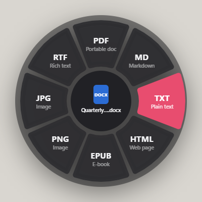
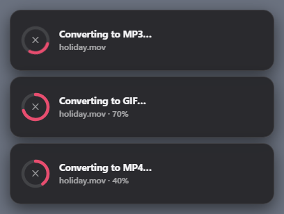
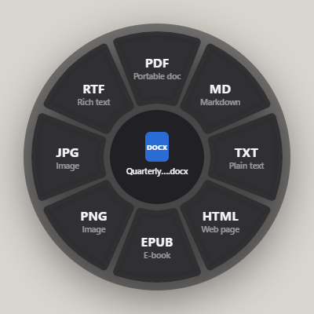
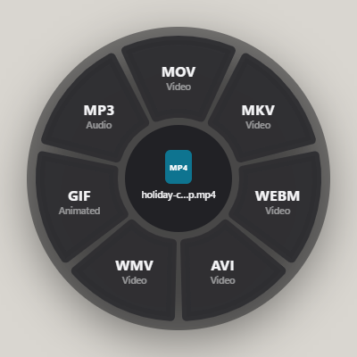
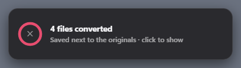
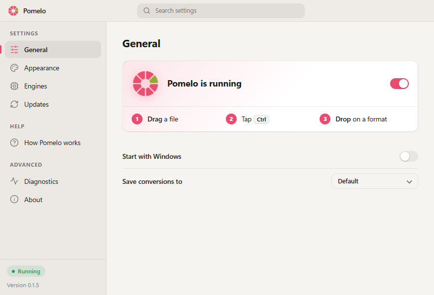

<p align="center">
  
</p>

<h1 align="center">Pomelo</h1>

<p align="center">
  <b>Drag a file. Tap Ctrl. Drop it on a format.</b><br>
  A zero-click file converter for Windows that runs entirely on your PC.
</p>

<p align="center">
  <a href="https://pomelo.swymble.com"><b>Visit the website</b></a>
  &nbsp;·&nbsp;
  <a href="https://github.com/zzvimalzz/pomelo/releases/latest">Download</a>
</p>

<p align="center">
  <a href="LICENSE"></a>
  
  
</p>

<p align="center">
  
  &nbsp;&nbsp;
  
</p>

> ### Fully offline, fully on your device
> Every conversion happens on your computer. There is no account, no upload, no cloud service and no telemetry, so **your files never leave your PC**. Pomelo only goes online when you ask it to: installing an optional engine, clicking **Check for updates**, or, if you switch on **Check automatically**, a once-a-day look for a newer version (it never downloads one by itself).

## How it works

1. **Drag** a file or folder in Explorer, or an icon on the desktop. Hold the left mouse button.
2. **Tap Ctrl** while dragging. A wheel of formats opens at the cursor.
3. **Drop** on a segment. The converted copy is saved next to the original, or in the folder you chose in the **Save conversions to** dropdown in Settings. Your original is never changed.

Prefer a menu? Right-click a file and choose **Convert with Pomelo** (on Windows 11 it is under **Show more options**), then click a format. Pomelo adds that entry for your user account when it starts, and removes it when you uninstall. The **?** button next to the name in Settings opens a short guide with an animation of the gesture and a few questions.

Esc cancels. The appearance (System, Light or Dark) can be changed in Settings. Progress and results show in small toasts in the bottom-right corner, never over your work. Click a finished toast to show the file, or the ✕ in a progress ring to cancel (partial files are deleted).

## Screenshots

<table>
  <tr>
    <td align="center"><br><sub>A document: PDF, Markdown, text, HTML, EPUB, RTF and images</sub></td>
    <td align="center"><br><sub>A video: other video formats, GIF or audio only</sub></td>
  </tr>
  <tr>
    <td align="center"><br><sub>Conversions run in parallel and stack, with a cancel button on each</sub></td>
    <td align="center"><br><sub>Beyond three they fold into one summary. Click it to show the files</sub></td>
  </tr>
  <tr>
    <td align="center" colspan="2">
      <picture>
        <source media="(prefers-color-scheme: dark)" srcset="assets/screenshots/settings-dark.png">
        
      </picture>
      <br><sub>Settings can follow your Windows theme or stay light or dark. Pomelo lives in the tray</sub>
    </td>
  </tr>
</table>

## Install

Download **Pomelo-Setup-x64.exe** from the [latest release](https://github.com/zzvimalzz/pomelo/releases/latest) and run it. It needs no administrator rights and takes three short screens:

1. **Where to install.** The default is per-user (`%LOCALAPPDATA%\Programs\Pomelo`).
2. **Conversion engines.** Optional extras: editable PDF to Word, reading scanned PDFs (OCR), Office, Markdown and HEIC conversion. They are downloaded during setup with a progress bar. Pomelo works without them, and you can add or remove them later in Settings.
3. **Shortcuts.** A desktop shortcut and "Start Pomelo with Windows", then **Install**.

Every release lists the SHA-256 checksum of the installer. Early releases may not be code-signed yet, in which case Windows SmartScreen can show "Windows protected your PC": check the checksum, then choose **More info > Run anyway**. Uninstall from Windows Settings > Apps, or from Pomelo's own Settings > Advanced. Both remove only what Pomelo installed.

Prefer to build it yourself? See [Build from source](#build-from-source).

## What converts to what

The wheel offers up to 8 targets per file.

| Kind | Inputs | Targets |
| --- | --- | --- |
| Images | JPG PNG WEBP HEIC TIFF AVIF BMP GIF SVG | JPG PNG WEBP HEIC TIFF AVIF BMP GIF PDF (SVG is input only; animated GIF and WebP keep their animation when converted to each other) |
| Video | MP4 MOV MKV WEBM AVI WMV M4V MPG FLV | MP4 MOV MKV WEBM AVI WMV, GIF (whole clip, frame rate and size scale down for longer clips, up to 5 minutes), MP3 (audio only) |
| Audio | MP3 WAV OGG M4A FLAC OPUS AIFF WMA AAC | MP3 WAV OGG M4A FLAC OPUS AIFF WMA |
| PDF | PDF | DOCX PPTX XLSX (tables) PNG/JPG (every page) TXT MD EPUB HTML DOC |
| Documents | DOCX DOC RTF ODT MD TXT HTML EPUB | PDF DOCX MD TXT HTML EPUB RTF DOC ODT, PNG/JPG (every page) |
| Slides | PPTX PPT | PDF PNG JPG PPT/PPTX |
| Spreadsheets | XLSX XLS ODS CSV TSV | XLSX XLS ODS CSV TSV HTML JSON PDF |
| Subtitles | SRT VTT | SRT VTT TXT |
| Archives | ZIP 7Z TAR GZ (tar.gz or single file) RAR | FOLDER (extract next to the archive), ZIP 7Z TAR GZ (RAR is input only) |
| Folders | any folder | ZIP 7Z TAR GZ (tar.gz) |

**PDF to Word is always editable.** Every page is rebuilt as the document someone would have typed: real paragraphs with their indents, alignment and line spacing, real bullet and numbered lists, real Word tables (ruled ones, and side-by-side blocks such as columns or a header with an address as borderless tables), shaded boxes, hyperlinks, underline and highlight, fonts, sizes and colours, and the same page size and page count. Only what is a picture in the PDF (photos, logos, charts, shapes, gradients) stays a picture, in line with the text or behind it. Text that sits on a picture (a title over a photo) is a positioned paragraph that you can still retype. **Scanned PDFs** are read with OCR first (RapidOCR, offline) and come out as real text too; every PDF conversion benefits, not only Word. A PDF cannot say how its lines wrapped or which font you have, so a page can break differently when the fonts it uses are not installed on the PC that opens the Word file.

**PDF to Markdown, HTML, text and EPUB** read the PDF once and agree: all of the text in reading order (columns one after the other, a title and its date on one line), headings, bullet and numbered lists, tables, links, bold and italic, code, and pictures (saved next to the Markdown, embedded in HTML and EPUB). Headers, footers and page numbers that repeat on every page are left out. **PDF to Excel** takes ruled tables as they are drawn, finds the aligned rows of borderless ones, and for a PDF with no table at all gives each page's text lines. **PDF to PowerPoint** puts text boxes at the original places on a picture of everything else, links kept.

Not supported: Apple Pages (`.pages`) and RTFD, because Apple's own software is the only thing that can write them reliably. RAR is input only: creating RAR needs WinRAR's closed-source compressor.

## Privacy and security

- **On your device.** Files are converted locally and nothing is uploaded. There is no telemetry and no account.
- **No remote fetches while converting.** The PDF print window and Pandoc are blocked from loading remote resources, so a document that links to an online image does not make a request. LibreOffice can still fetch linked content in some Office files.
- **Network use is your choice.** The only requests Pomelo makes itself are installing an optional engine and the update check, which runs when you click **Check for updates** or, only if you turn it on, once a day (**Check automatically**, off by default; it only tells you, the download starts when you press the button, and goes straight to GitHub; an engine the update adds to components you already installed is downloaded as part of it).
- **No keylogging.** Drag detection uses a Windows input hook in a small helper, `pomelo-input.exe` ([source](native/pomelo-input.cs), one short file, no network code). It reports only the left mouse button and the mouse position while that button is held, plus Ctrl and Esc while that button is held. Other keys are never recorded, and nothing it sees is stored or logged.

Found a vulnerability? Please report it privately, see [SECURITY.md](SECURITY.md).

## Optional engines

Pomelo works out of the box for images, video, audio, archives, subtitles, EPUB, Markdown/HTML/TXT, CSV/XLSX and basic DOCX/PDF. Optional engines add fidelity. Open **Settings > Advanced** and click **Conversion engines** to open the list: anything not installed shows an **Install** button. The PDF engine, OCR and HEIC export share one private Python environment in `%LOCALAPPDATA%\Pomelo\engines`. LibreOffice is the official download, unpacked into that same folder (about 1 GB, no administrator permission, no extra shortcuts), and Pandoc comes from winget. Pomelo remembers what it installed, so **Uninstall** removes only that. Engines you installed yourself are detected automatically (PATH, standard install folders, or a `vendor/` folder) and never removed.

<details>
<summary>Install the engines from a terminal</summary>

```bash
winget install TheDocumentFoundation.LibreOffice   # Office formats, high-fidelity PDF export, PDF to editable PPTX
winget install JohnMacFarlane.Pandoc               # Markdown / HTML / RTF / ODT / EPUB quality
npm run setup:pdf                                  # developer setup: PDF to Word/Excel/Markdown/slides, OCR and HEIC export in vendor/pyenv (needs Python 3.9+)
```

</details>

<details>
<summary>Engines and licences (all open source)</summary>

| Engine | Licence | Role |
| --- | --- | --- |
| Built-in JS: SheetJS, mammoth, marked, turndown, docx, html-to-docx, pdf.js, pdf-lib, sharp, heic-convert, JSZip, word-extractor, pptxgenjs | Apache-2.0 / MIT / BSD / ISC (heic-convert bundles LGPL libheif) | Always on: PDF, DOCX, XLSX/XLS/ODS, CSV/TSV, MD, HTML, TXT, EPUB, images, subtitles |
| [FFmpeg](https://ffmpeg.org) via `ffmpeg-static` | GPL-3.0-or-later build, separate process | All video and audio, with progress |
| [7-Zip](https://www.7-zip.org) via `7zip-bin` | LGPL, separate process | ZIP, 7Z and TAR, including accented and CJK file names |
| Windows `tar.exe` (libarchive) | BSD | Reading RAR |
| [LibreOffice](https://www.libreoffice.org) (optional) | MPL-2.0 | DOC/DOCX/RTF/ODT/XLS/XLSX/ODS/PPT/PPTX to PDF and between each other; the fallback for PDF to PPTX and for PDF to DOC/ODT/RTF |
| [Pandoc](https://pandoc.org) (optional) | GPL-2.0-or-later, separate process | Markdown / HTML / RTF / ODT / DOCX / EPUB |
| [python-docx](https://github.com/python-openxml/python-docx) (optional, Python) | MIT | Writes the Word file for PDF to DOCX (`python/pdf_flow/`) |
| [RapidOCR](https://github.com/RapidAI/RapidOCR) with ONNX Runtime (optional, Python) | Apache-2.0 / MIT | Reads scanned PDF pages (`python/pdf_ocr.py`); its PP-OCR models are fetched once when the engine is installed |
| [PyMuPDF](https://pymupdf.readthedocs.io) (optional, Python) | AGPL-3.0-or-later or Artifex commercial; separate process | Reads every PDF: PDF to Word (`python/pdf_flow/`), PowerPoint, Markdown, HTML, text, EPUB and Excel (`python/pdf_to_text.py`, `pdf_structure.py`, `pdf_layout.py`, `pdf_to_tables.py`) |
| [pillow-heif](https://github.com/bigcat88/pillow_heif) (optional, Python) | BSD-3 (bundles libheif and the GPL x265 encoder) | Writing HEIC. Reading HEIC works without it |

Engine order per conversion lives in `src/features/conversion/routing/plans.js`; if one engine fails, the next is tried.

</details>

## Updates

Settings shows your version, a **Check for updates** button and a **Check automatically** switch. If a newer version exists the button becomes **Download update** (with **Check automatically** on, a toast tells you and opens Settings when clicked). A small **Pomelo Downloader** window then shows the stage and the percentage while Pomelo downloads the installer from the latest [GitHub release](https://github.com/zzvimalzz/pomelo/releases) itself, checks it against the SHA-256 published with the release, installs it quietly over the current copy and starts again: no browser, no installer window. You can minimise the window; **Cancel** stops the download. Windows cannot replace a running program, so Pomelo closes for a few seconds while the files are swapped and reopens by itself (with Settings open again if it was). If the update adds an engine to the PDF components you already have, such as OCR, Pomelo adds it automatically. A download that does not match its checksum is discarded and nothing is installed. Your settings and engines are untouched. If a release has no checksum, or you run Pomelo from source, the button opens the download page instead. Forks can point it at their own releases in `package.json`:

```json
"pomelo": { "updateRepo": "owner/name" }
```

(or `"updateFeed": "https://example.com/latest.json"` with `{ "version": "1.2.0", "url": "https://..." }`.)

## Known limits

- Only drags that start in File Explorer or on the desktop are detected, and not from windows running as administrator.
- OCR reads Latin-script text (English and similar languages) in scans; pictures inside a scanned page are not kept, only its text. Rotated text (a stamp, a margin label), symbol-font glyphs and right-to-left text in a PDF stay as pictures in the Word file.
- PDF to Word needs the PDF engine; without it a basic rebuild of headings and paragraphs is used.
- Without the optional engines: `.doc` input is text-only, and `.ppt/.pptx` cannot be converted.
- RAR: no encrypted or multi-part archives.
- Large files are processed in memory by the built-in engines.

## Build from source

Requirements: Windows 10/11 and Node 20+.

```bash
git clone https://github.com/zzvimalzz/pomelo.git
cd pomelo
npm install
npm start
```

`npm start` first compiles the small input helper (`native/pomelo-input.cs`) with the C# compiler that ships with Windows, so nothing else needs installing. The app lives in the tray; Settings opens on every manual start.

To build the installer yourself (needs [Inno Setup 6](https://jrsoftware.org/isinfo.php)):

```bash
npm run package            # dist/Pomelo-win32-x64: the app with its own Electron
npm run build:installer    # dist/installer/Pomelo-Setup-x64.exe
```

## Contributing and tests

See [CONTRIBUTING.md](CONTRIBUTING.md). In short:

```bash
npm run check      # ESLint, unused-code scan, and a check that no private notes are tracked
npm test           # job logic, input helper, updater, routing snapshot, full conversion matrix, edge cases
npm run test:ui    # wheel, toast and settings windows (also regenerates the screenshots in test/shots)
npm run fidelity:samples && npm run test:fidelity   # PDF to Word: convert, print back to PDF, score against the original (needs the engines)
```

Dev tools in `tools/`: `build-helper.js` (compiles the input helper), `package.js` and `build-installer.js` (release build), `pdf-inspect.mjs` (what is inside a PDF), `render-docx.sh` (DOCX to images, to eyeball fidelity), `make-notices.js` (regenerates the third-party list), `py-licenses.py`, `unused-exports.js`, `check-boundaries.js`, `check-public.js`.

## Licence

Pomelo is free software under the **GNU Affero General Public License v3.0 or later** ([LICENSE](LICENSE)). It builds on many open-source projects; see [THIRD_PARTY_NOTICES.md](THIRD_PARTY_NOTICES.md). Contributors keep their copyright and agree to the [Contributor Licence Agreement](CLA.md).

Pomelo is inspired by [Tangerine for Mac](https://tangerineformac.com/). It is an independent project and shares no code or assets with it.
